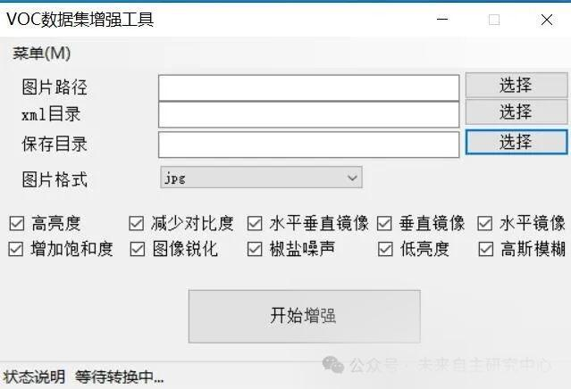

# [Windows Tools] VOC Dataset Augmentation Tool Tutorial

Welcome to the VOC Database Augmentation Tool! This tool aims to enhance your VOC dataset images for improved model training accuracy and recognition capabilities, adapting to various application needs. Below are detailed steps on how to use this tool: First, obtain the tool by visiting https://firc.lanzn.com/iNrsF2mzg93i

1. Open the software

Double-click the FIRC.exe in the software directory.

II. Software Interface Introduction

Title bar: Displays the software name "VOC Database Enhancement Tool".

Option box: contains multiple enhancement options, such as high brightness, reduce contrast, horizontal mirroring, etc.

Button area: "Select" and "Start Enhancement" buttons for selecting paths and starting enhancement processing.

Input box: Corresponding path, note that the last part of the path should be removed, such as D:\mydata\ to be changed to D:\mydata.

III. Usage Steps

Selecting a path:

Click the "Select" button on the interface.

In the pop-up file selection dialog box, navigate to the folder containing the VOC database images you want to enhance.

Select one or more image files and then click the "Open" or "OK" button.

The folders for annotation and saving are operated in the same way.

Set Enhancement Options:

Select the appropriate enhancement option from the dropdown list based on your requirements. For example, if you want to increase the brightness of an image, you can choose "High Brightness"; if you want to reduce contrast, you can select "Reduce Contrast" among others.

Note, all enhancement algorithms are selected by default.

Starting the enhancement process:

After confirming all settings are correct, click the "Start Enhancement" button.

The software will begin processing the image you selected and apply the enhancement options you have chosen.

After processing, enhanced images can be found in the specified save directory.

The final effect is as follows:

IV. Notes

When dealing with a large number of images, please ensure that your computer has sufficient memory and storage space.

When selecting enhancement options, please make careful choices based on your actual needs to avoid over-processing or unnecessary processing.

If any issues or error messages occur during the processing, please refer to the software's help documentation or contact the software developers for support.

We hope this tutorial can help you use VOC database enhancement tool smoothly! If you have any questions or suggestions, please contact us at any time.

## Payment

Here is a pay link on Stripe ( https://buy.stripe.com/3cs8yP7sY87d0vu9AB ). Please contact me lonlonago@foxmail.com after funding $89, and I will send you a complete data files , thank you!

